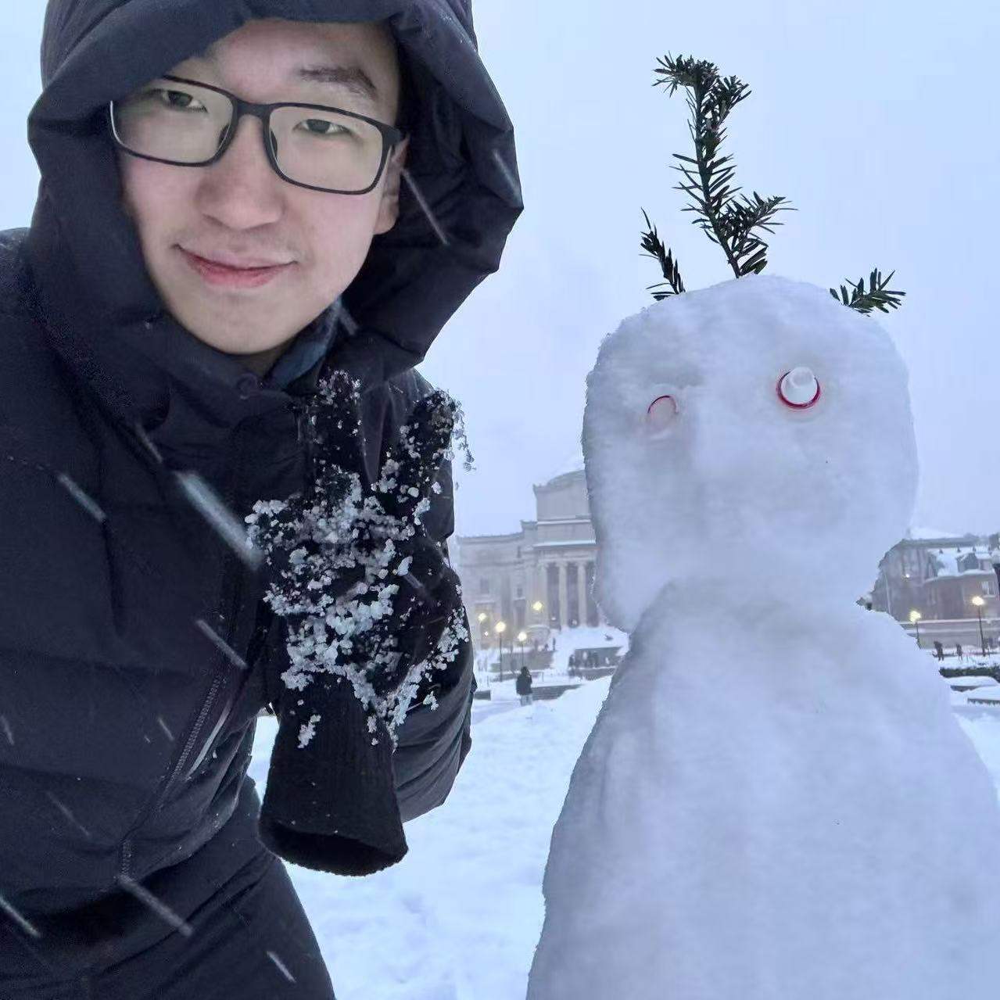

# Huikang Jiang’s personal website

Personal academic website for https://huikangjiang06.github.io/, based on the current résumé. The layout is inspired by [Naimeng Ye’s website](https://naimengye.github.io/); the HTML and CSS are maintained directly here.

## Files

- `index.html`: introduction, résumé content, contact links, and paper links.
- `styles.css`: responsive styling, including automatic dark mode.
- `assets/huikang-jiang-cv.pdf`: English CV.
- `assets/huikang-jiang-cv-bilingual.pdf`: Chinese-first bilingual CV.
- `.nojekyll`: serves the files as a plain static website on GitHub Pages.

No build step, packages, API keys, or external fonts are required.

## Preview locally

From this directory, run:

```sh
python3 -m http.server 8765 --bind 127.0.0.1
```

Open http://127.0.0.1:8765/.

## GitHub Pages

In the repository’s **Settings → Pages**, choose **Deploy from a branch**, select **main** and **/(root)**, and save. The site will be published at https://huikangjiang06.github.io/. Later pushes to `main` update the site automatically.

## Updating content

Edit `index.html` to change text or links. Replace the two PDFs in `assets/` when the résumé changes; keep their filenames so existing links continue to work. The current paper review status is copied from the résumé: ICLR 2027.

The profile photo space is intentionally empty. When a photo is ready, add it as `assets/profile.jpg` and replace the empty `div.profile-photo` in `index.html` with:

```html

```

Check the desktop and mobile layouts before committing and pushing edits.
